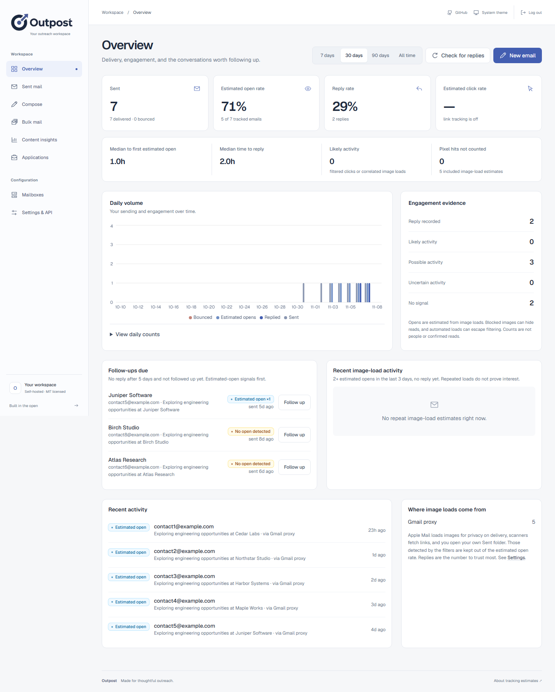
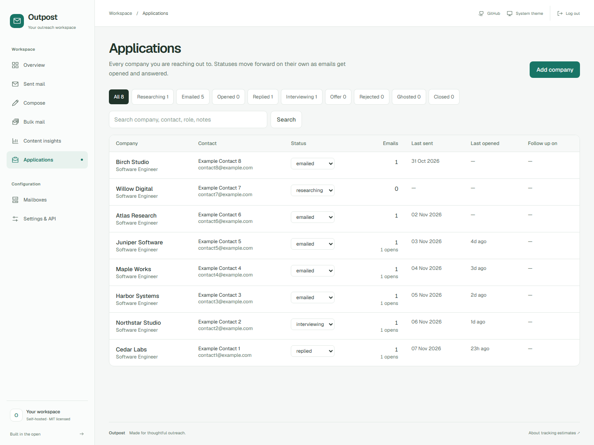

# Outpost

[](https://github.com/naman777/outpost/actions/workflows/ci.yml)
[](LICENSE)


Self-hosted email tracking (opens, clicks, replies, bounces) plus a job-application pipeline that replaces the Excel tracker. Next.js 16, Postgres (Neon works out of the box), Drizzle.

Built for one person's outreach workflow. Each installation has one dashboard password and one set of data; this is not a multi-user hosted service. Gmail API and SMTP/IMAP connections are supported, subject to your provider's authentication rules.

Start with the [setup guide](docs/setup.md). Read [security and stored data](docs/security.md) before exposing your installation to the internet. For imports, use the [portable JSON format](docs/importing.md).

## How email tracking works

| Signal | How it's caught | How reliable |
| --- | --- | --- |
| **Open** | Every email gets a unique 1×1 GIF (`/t/o/<id>.gif`). When the mail client loads images, the request is logged. | Medium. See below. |
| **Click** | Optional. Links are rewritten to `/t/c/<id>`, which logs and 302-redirects to the real URL. | A signal; scanners can look like real browsers. |
| **Reply** | The app reads the sending mailbox (Gmail API threads, or IMAP `In-Reply-To` / sender match) and links answers to the email. | Thread matches are stronger than sender-based fallbacks. |
| **Bounce** | Mailer-daemon reports are matched by the Message-ID quoted inside them. | High. |

Pixel hits are classified before they count as an open:

- **Gmail proxy** requests are estimates, not verified views; the grace period applies to them too.
- **Possible Apple privacy loads** are shown with uncertainty and excluded automatically, including repeat loads.
- **Security scanners / bots** (empty or bot user agents) → not counted.
- **Hits in the first N seconds after sending** could be rapid reading or prefetch → excluded from estimates (`graceSeconds`, default 20).
- **You**: hits carrying the dashboard's cookie or coming from the IPs you use the dashboard from → not counted. Opening your own email in Gmail's Sent folder goes through Google's proxy and can't be told apart; use "this was me" on the message page.
- Eligible loads less than 60 seconds apart within the same source/IP context form one burst. The pixel asks clients not to cache it, but mail proxies can still cache or prefetch images.

An open is an estimate, not proof someone read your email. Forwarded mail, blocked images, caches and privacy features can affect attribution. Filtering uses heuristics and will miss some automated traffic.

Estimated open rate is computed only over emails that carried a pixel and didn't bounce. Reply rate is over everything delivered (including imported mail without a pixel). Click rate is over emails with click tracking on.

Confidence and engagement are explained in [the tracking guide](docs/open-tracking.md). Replies and clicks stay separate from pixel counts. The dashboard shows estimated opens, raw loads, per-event confidence, source breakdowns and engagement evidence; none of these metrics is a read receipt. Existing installations need the additive schema update and historical rebuild described in that guide.

## Three ways to use it

1. **Connected mailbox: Gmail via Google sign-in.** Sends with the Gmail API (links are not rewritten into `google.com/url`), finds replies by thread. Needs your own Google Cloud OAuth client.
2. **Connected mailbox: SMTP + IMAP.** Sends over SMTP and reads replies and bounces over IMAP. Host presets are provided for common services, but a preset does not guarantee password authentication is enabled by that provider. See the Gmail app-password walkthrough in the setup guide. Each mailbox has its own send limit.
3. **General, no connection.** Track mail you send from anywhere:
   - **Compose → "Any mail client"** gives you the email with the pixel built in. Copy it, paste into Gmail/Outlook web, send.
   - **API**: `POST /api/v1/messages` registers an email and returns the HTML with the pixel and a Message-ID. Send it with your own script. See [clients/outpost_client.py](clients/outpost_client.py).
   - If the `from` address is also connected (option 2), replies to this mail are found too.

## Setup

```bash
git clone https://github.com/naman777/outpost.git
cd outpost
npm ci
npm run setup               # creates .env.local with independent random secrets; never overwrites
# Set DATABASE_URL in .env.local to your own empty Postgres database.
npm run setup:check         # validates configuration without printing secrets
npm run db:push              # creates the tables
npm run dev
```

Requires Node.js 20.9+ and Postgres; Node.js 22 LTS is a convenient baseline. Open http://localhost:3000 and sign in with the generated DASHBOARD_PASSWORD from your local file. **Remote tracking needs a public HTTPS APP_URL**. See the [complete local and Vercel instructions](docs/setup.md), including database and mailbox checks.

- Set APP_URL to your app's actual public origin, such as https://mail.example.com; no trailing path. Tracking URLs already sent in emails keep using their original domain.
- `vercel.json` requests a daily reply/bounce check at 03:00 UTC. "Check for replies" runs it on demand. Sync is polling, not a live inbox feed.
- Google OAuth is optional and needs your own Google Cloud client. Gmail read access is a restricted scope; follow the [OAuth setup and verification notes](docs/setup.md#optional-gmail-api-oauth).

### Scripts

| Command | What it does |
| --- | --- |
| `npm run import:tracker -- --file examples/import.json --from you@example.com --dry-run` | Validates a fictional JSON export without connecting to the database. See docs/importing.md. |
| `npm run add:mailbox -- --email you@example.com --preset gmail --name "You"` | Adds a mailbox using MAILBOX_PASSWORD from the process environment. The dashboard is easier for first setup. |
| `npm run db:push` / `db:studio` | Schema sync / browse the database. |

## API

All `/api/v1/*` routes take `Authorization: Bearer $API_KEY`.

| Route | |
| --- | --- |
| `POST /api/v1/messages` | Register mail you send yourself → `{ id, html, messageId, pixelUrl, pixelHtml }` |
| `PATCH /api/v1/messages/:id` | Report a failed send or the real Message-ID |
| `GET /api/v1/messages?to=` | Status of sent mail (opens, clicks, reply) |
| `POST /api/v1/send` | Send through a connected mailbox (`from` or `accountId`), with attachments |
| `GET /api/v1/stats?days=30` | Totals and rates |

## Deliverability notes

- Open and click tracking can affect deliverability. Neither mode guarantees inbox placement. Click tracking is off by default; the API also accepts `trackOpens: false`. See [tracking controls](docs/open-tracking.md).
- Every mailbox has a daily limit (default 20). Sends past it are refused.
- Plain-text part is always included and keeps links exactly as written.

## Verification

```bash
npm test
npm run typecheck
npm run lint
npm run build
npm run test:smoke
npx playwright install chromium
npm run test:browser
```

These checks do not send mail. The smoke check starts a built app against an isolated, in-memory Postgres engine, pushes the schema and checks login, imports, dashboard pages, API validation and tracking endpoints. It never uses your DATABASE_URL or mailbox. See the setup guide for a controlled end-to-end check using a mailbox and recipient you own. Follow-ups are composed manually; the app does not run automated campaigns or maintain an unsubscribe/suppression system.

## Layout

```
src/app/t/o/[id]      pixel endpoint          src/lib/tracking.ts   pixel/link rewriting, open classification
src/app/t/c/[id]      click redirect          src/lib/send.ts       create tracked message, send via Gmail API / SMTP
src/app/api/v1        public API              src/lib/sync.ts       reply + bounce detection (Gmail API, IMAP)
src/app/(dash)        dashboard pages         src/lib/stats.ts      rates, breakdowns, follow-ups due
src/db/schema.ts      tables                  scripts/              importer, add-mailbox CLI
```

## Screenshots

These are real app screens captured with fictional data in a disposable local database. No real inbox is connected.





To regenerate: `npm ci`, `npx playwright install chromium`, `npm run build`, then `npm run screenshots`. This runs the isolated smoke checks and captures the fixture dashboard without using your database or sending mail.

## Deploy your own installation

Follow the [production setup guide](docs/setup.md#deploy-on-vercel) and [launch checklist](docs/launch-checklist.md). You need a separate Postgres database, independent production secrets, and a stable HTTPS origin. Schema initialization is a manual step; deploying the app does not initialize the database.

## Contributing and security

See [CONTRIBUTING.md](CONTRIBUTING.md) for local checks and pull requests, [CODE_OF_CONDUCT.md](CODE_OF_CONDUCT.md) for community expectations, and [SECURITY.md](SECURITY.md) to report a vulnerability privately. Bug reports and feature requests belong in [GitHub Issues](https://github.com/naman777/outpost/issues).

For new Python integrations, import `outpost_client` and set `OUTPOST_URL` and `OUTPOST_API_KEY`. Existing `mailpulse_client` imports and `MAILPULSE_URL` / `MAILPULSE_API_KEY` variables remain supported.

## License

[MIT](LICENSE), copyright 2026 Naman Kundra.
